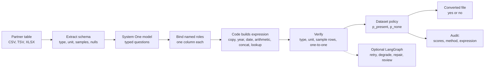

# Column Mapping with System One Model

[](https://www.python.org/)
[](https://openrouter.ai/docs/guides/features/decisions)
[](https://docs.langchain.com/oss/python/langgraph/graph-api)
[](https://deepeval.com/)

**Maps a partner's columns onto your target template, then decides every output field yes or no with a
calibrated System One policy.**

A partner sends a table. The target template describes each output field. The System One model reads
the schema we extract, binds each named role of a field to one input column, and returns calibrated
probabilities. Code builds the expression, verifies it, applies a dataset policy, and writes the
converted file. The model never sees the ground truth, and the output is always binary: filled or
empty, never "maybe".

> **Project status: work in progress.** Implemented: schema extraction, role binding, presence gate,
> prompt and policy registries, table CLI, LangGraph harness, and DeepEval metrics. Not implemented:
> monitoring/drift dashboards, PII redaction, and shadow/canary automation; the checklist is in
> [docs/PRODUCTION.md](docs/PRODUCTION.md).
>
> Dev baseline, seed 11 with `microsoft/microsoft-decision-1.1`: **122 / 124 fields right**,
> 73 / 74 with a source, 49 / 50 without a source, 73 / 74 fill precision. The two remaining errors
> are semantic ambiguity in the synthetic template; 100% is not promised. See
> [docs/PRODUCTION.md](docs/PRODUCTION.md#why-100-is-not-a-natural-target).

## What you will see

| Output | Shows |
|---|---|
| Converted file | One row per partner row; a field is filled or empty, with the expression that built it |
| Decisions CSV | Per field: chosen columns, expression, `p_present`, `p_none`, filled, ground truth in the bench |
| Audit JSONL | Per field: run id, model, policy, scores, method, columns, expression; no ground truth |
| Calibration policy | Derived/copy floors, model version, calibration run, point estimate, 95% upper bound |
| Graph review | Optional pause for fields close to the policy; `review="empty"` resolves to no in production |

## Architecture



- **Core library (`src/column_mapping`)** owns the schema, prompt registry, role parser, expression
  AST, pipeline, policy, and the table reader. The core uses the standard library only.
- **Bench (`src/column_mapping/bench`)** owns the synthetic template, seeds, ground truth, report,
  calibration, DeepEval, and the CLI.
- **Harness (`src/column_mapping/harness`)** is the optional LangGraph agent around the same pipeline.
  It needs the `graph` extra and is never imported by the core.

Details: [docs/ARCHITECTURE.md](docs/ARCHITECTURE.md).

## Knowledge folder

One dataset is one source-controlled folder:

```
my_knowledge/
  outputs.json       target template: name, type, description
  reference/*.csv    code -> label tables for lookups
  prompts.json       editable overrides of the built-in prompt book
  policy.json        calibrated floors, model version, calibration facts
```

`make data` writes a complete example to `data/knowledge/`. Copy it into your project before editing;
`make data` regenerates the example but keeps a calibrated `policy.json`.

## Design choices

| Choice | Why |
|---|---|
| Read the description as named roles, bind each role in code | The model judges meaning; code owns the formula and units |
| Gate on presence (`p_present`) and `p_none` | A joint set score alone forced fields that had no source |
| One policy per dataset | A global threshold per batch drifts; a policy travels with the data and model |
| Calibrate, do not hand-tune | `make calibrate` records the point estimate and the 95% upper bound |
| Binary output | A field is yes or no; empty is a valid no, never an open question |
| Prompt and policy registries | The folder, MLflow, and the built-in book are versioned; the folder wins |
| Optional graph with retry/degrade/repair | Production reliability without making the core an agent |
| Audit every decision | Scores, method, columns, expression, model, and policy are explainable |

## Quick start

Prerequisites: Python 3.12+ and `uv`.

```bash
git clone https://github.com/raihanpka/system-one-experiment
cd system-one-experiment
cp .env.example .env          # then put OPENROUTER_API_KEY in .env
uv sync
make check                    # format check, lint, tests; no model call
```

Map a partner table with your knowledge folder:

```bash
uv run column-mapping --table in.xlsx --knowledge my_knowledge/ --output converted.csv
uv run column-mapping --table in.csv --schema --json
uv run column-mapping --table in.csv --audit audit.jsonl --json
uv run column-mapping --table in.csv --graph --review empty
```

Calibrate the dataset policy from a labeled run (no model call):

```bash
make calibrate RUN_DIR=results/<labeled run> BUDGET=0.02
```

Rebuild a report with other floors, no model:

```bash
uv run column-mapping --report-only --fill-score 0.8 --copy-fill-score 0.5
```

Settings: `appsettings.json` holds the model, default seed (3407), and split seeds;
`knowledge/policy.json` holds the dataset floors; `appsettings.local.json` and
`COLUMN_MAPPING__Section__Key` override. See [docs/CONFIGURATION.md](docs/CONFIGURATION.md).

## Data

The bench uses a synthetic insurance/finance template. Seeds generate different samples:
`Dev` 11, `Holdout` 12/13, `Test` 21/22, and the default sample seed 3407. The model never sees the
template rule, kind, or source id. Partner data is never committed; the example data is generated by
`make data`.

## Repository layout

```
src/column_mapping/        core library, bench, optional graph harness
data/                      generated template, samples, knowledge folder
results/                   run output; not committed
docs/                      architecture, configuration, production, conventions
tests/                     unit and bench tests; no network
```

## Documentation

| Document | About |
|---|---|
| [docs/ARCHITECTURE.md](docs/ARCHITECTURE.md) | Components, flow, knowledge folder, graph harness |
| [docs/CONFIGURATION.md](docs/CONFIGURATION.md) | Settings precedence, seeds, policy |
| [docs/PRODUCTION.md](docs/PRODUCTION.md) | Readiness, calibration/recalibration, monitoring, rollback |
| [docs/CONVENTIONS.md](docs/CONVENTIONS.md) | Code and reporting rules |

## Out of scope

A hosted multi-tenant service, a web UI, per-row LLM calls, training or fine-tuning the model,
agent actions that change partner data, and a 100% accuracy guarantee.

## Contributing and license

Read [AGENTS.md](AGENTS.md) before changing code or running the model. Report security issues
privately to the repository owner. Copyright &copy; 2026 Raihan Putra Kirana. All rights reserved.
