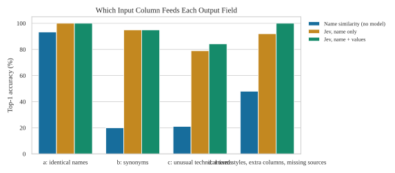
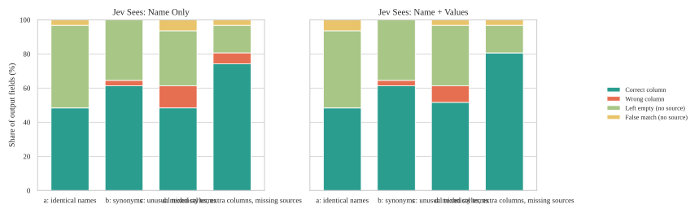
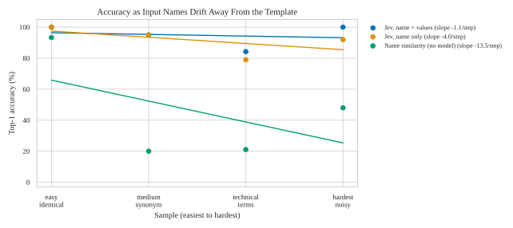
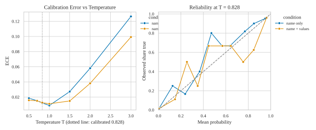
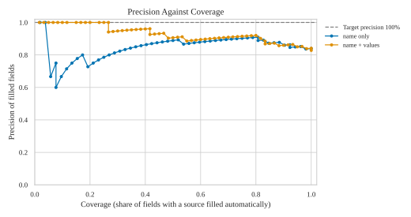

# Results

Model: Jev-Style-2B-Decision-v3 (llama.cpp, local). Output fields are always given by name only. For each input column the model sees: **name only** = the header text; **name + values** = the header and 5 values taken from the rows (file keys: `name`, `samples`).

| sample | input, expected, ground truth | Jev outputs (this run) | input naming |
|---|---|---|---|
| a | data/samples/a_easy_identical/ | a_easy_identical/ | identical names |
| b | data/samples/b_medium_synonym/ | b_medium_synonym/ | synonyms |
| c | data/samples/c_technical_terms/ | c_technical_terms/ | unusual technical terms |
| d | data/samples/d_hardest_noisy/ | d_hardest_noisy/ | mixed styles, extra columns, missing sources |

Per sample and context: the converted file (made without ground truth), the decisions and the probability matrix. Raw model output for everything: `result.json`.

## At a Glance

- **name only, options mode**: top-1 91.1%, exact 86.1%. Fields without a source left empty: 91.1% with the fixed rule. Without ground truth help: 47 of 79 fields correct, 58.3% of cells correct, 78 cells wrongly filled. 19 s per file.
- **name + values, options mode**: top-1 94.9%, exact 91.1%. Fields without a source left empty: 91.1% with the fixed rule. Without ground truth help: 53 of 79 fields correct, 66.3% of cells correct, 72 cells wrongly filled. 19 s per file.

Heatmaps: `figures/heatmap_<sample>_<context>.svg`.

## Auto-Fill or Review

- name only: uncalibrated, so every answered field is filled and there is no precision guarantee.
- name + values: uncalibrated, so every answered field is filled and there is no precision guarantee.

Fields below the cutoff stay empty in `converted_*.csv` and are listed with three candidates in `review_*.csv`. Precision counts a filled field as right only when every cell matches; a field without a source that was filled counts as wrong. Coverage is the share of fields with a source that were filled.

| Jev sees | sample | fields filled | filled correct | precision % | coverage % | fields to review |
|---|---|---|---|---|---|---|
| name only | easy_identical-000 | 13 | 12 | 92.3 | 80.0 | 18 |
| name only | medium_synonym-000 | 14 | 12 | 85.7 | 70.0 | 17 |
| name only | technical_terms-000 | 9 | 7 | 77.8 | 36.8 | 22 |
| name only | hardest_noisy-000 | 20 | 16 | 80.0 | 76.0 | 11 |
| name + values | easy_identical-000 | 14 | 12 | 85.7 | 80.0 | 17 |
| name + values | medium_synonym-000 | 16 | 14 | 87.5 | 80.0 | 15 |
| name + values | technical_terms-000 | 14 | 11 | 78.6 | 68.4 | 17 |
| name + values | hardest_noisy-000 | 20 | 16 | 80.0 | 76.0 | 11 |

## Calibration

No calibration fitted for this setup: probabilities are uncalibrated. Fit one with `--fit-calibration` on dev or calibration runs.

All numbers are percentages unless noted. Samples, easiest to hardest: easy_identical (names equal the template), medium_synonym, technical_terms (unusual technical terms such as OBJ_INFO_ADDR), hardest_noisy (mixed styles, extra columns, missing sources). One file per sample: read the numbers as indications.

## Converted File Without Ground Truth Help

Columns, transformation, and expression all come from the model's own choices. Fields correct = every cell matches the expected file. Wrongly filled = fields that have no source but were filled.

| Jev sees | sample | fields with a source correct | fields without a source wrongly filled | cells expected | cells correct % | wrongly filled cells |
|---|---|---|---|---|---|---|
| name only | easy_identical-000 | 12 of 15 | 1 of 16 | 225 | 80.0 | 15 |
| name only | medium_synonym-000 | 12 of 20 | 0 of 11 | 380 | 60.0 | 0 |
| name only | technical_terms-000 | 7 of 19 | 2 of 12 | 399 | 36.8 | 42 |
| name only | hardest_noisy-000 | 16 of 25 | 1 of 6 | 525 | 64.0 | 21 |
| name + values | easy_identical-000 | 12 of 15 | 2 of 16 | 225 | 80.0 | 30 |
| name + values | medium_synonym-000 | 14 of 20 | 0 of 11 | 380 | 70.0 | 0 |
| name + values | technical_terms-000 | 11 of 19 | 1 of 12 | 399 | 57.9 | 21 |
| name + values | hardest_noisy-000 | 16 of 25 | 1 of 6 | 525 | 64.0 | 21 |

## Mapping: Which Input Column Feeds Each Output Field (options mode)

### Jev sees: name only

| sample | cases | top1 | exact | top3 | reject n/a | decoy flagged | pair F1 | ECE |
|---|---|---|---|---|---|---|---|---|
| easy_identical | 1 | 100.0 | 93.3 | 100.0 | 93.8 | - | 80.0 | 0.014 |
| medium_synonym | 1 | 95.0 | 95.0 | 100.0 | 100.0 | - | 70.0 | 0.013 |
| technical_terms | 1 | 78.9 | 73.7 | 100.0 | 83.3 | - | 43.8 | 0.022 |
| hardest_noisy | 1 | 92.0 | 84.0 | 100.0 | 83.3 | 50.0 | 72.7 | 0.016 |
| all | 4 | 91.1 | 86.1 | 100.0 | 91.1 | - | 67.5 | 0.012 |

### Jev sees: name + values

| sample | cases | top1 | exact | top3 | reject n/a | decoy flagged | pair F1 | ECE |
|---|---|---|---|---|---|---|---|---|
| easy_identical | 1 | 100.0 | 93.3 | 100.0 | 87.5 | - | 77.4 | 0.014 |
| medium_synonym | 1 | 95.0 | 95.0 | 100.0 | 100.0 | - | 78.0 | 0.013 |
| technical_terms | 1 | 84.2 | 78.9 | 100.0 | 91.7 | - | 64.9 | 0.017 |
| hardest_noisy | 1 | 100.0 | 96.0 | 100.0 | 83.3 | 75.0 | 71.4 | 0.017 |
| all | 4 | 94.9 | 91.1 | 100.0 | 91.1 | - | 72.7 | 0.013 |

### Baseline without a model (string similarity of names only)

| sample | top1 | exact | top3 |
|---|---|---|---|
| easy_identical | 93.3 | 93.3 | 100.0 |
| medium_synonym | 20.0 | 20.0 | 40.0 |
| technical_terms | 21.1 | 21.1 | 21.1 |
| hardest_noisy | 48.0 | 40.0 | 60.0 |

## Temperature and calibration (pooled)

Probability = sigmoid((s_true - s_false) / T). T = 0.828 is the calibrated value. top1 does not depend on T.

Jev sees: name only

| T | ECE | Brier | pair F1 | precision | recall |
|---|---|---|---|---|---|
| 0.500 | 0.019 | 0.019 | 67.5 | 86.9 | 55.2 |
| 0.700 | 0.015 | 0.018 | 67.5 | 86.9 | 55.2 |
| 0.828 | 0.012 | 0.018 | 67.5 | 86.9 | 55.2 |
| 1.000 | 0.009 | 0.018 | 67.5 | 86.9 | 55.2 |
| 1.500 | 0.027 | 0.018 | 67.5 | 86.9 | 55.2 |
| 2.000 | 0.058 | 0.021 | 67.5 | 86.9 | 55.2 |
| 3.000 | 0.126 | 0.034 | 67.5 | 86.9 | 55.2 |

Jev sees: name + values

| T | ECE | Brier | pair F1 | precision | recall |
|---|---|---|---|---|---|
| 0.500 | 0.016 | 0.017 | 72.7 | 87.0 | 62.5 |
| 0.700 | 0.015 | 0.017 | 72.7 | 87.0 | 62.5 |
| 0.828 | 0.013 | 0.016 | 72.7 | 87.0 | 62.5 |
| 1.000 | 0.011 | 0.016 | 72.7 | 87.0 | 62.5 |
| 1.500 | 0.015 | 0.015 | 72.7 | 87.0 | 62.5 |
| 2.000 | 0.038 | 0.017 | 72.7 | 87.0 | 62.5 |
| 3.000 | 0.099 | 0.026 | 72.7 | 87.0 | 62.5 |

## Rejecting Fields Without a Source

A field is kept when its best input column passes the rule. Kept = fields with a source that are kept; Rejected = fields without a source that are left empty; Decoys = kept fields whose best column is a distractor. Cutoffs fitted on this run are optimistic (same data); cutoffs fitted on another run are a fair test.

| Jev sees | rule | kept % | rejected % | balanced % | top-1 when kept % | distractors |
|---|---|---|---|---|---|---|
| name only | fixed, probability 0.5 | 65.8 | 91.1 | 78.5 | 96.2 | 1 |
| name only | score cutoff -0.76, fitted on this run, optimistic | 75.9 | 88.9 | 82.4 | 93.3 | 1 |
| name only | lift cutoff 4.46, fitted on this run, optimistic | 74.7 | 84.4 | 79.6 | 94.9 | 1 |
| name + values | fixed, probability 0.5 | 75.9 | 91.1 | 83.5 | 96.7 | 0 |
| name + values | score cutoff -1.27, fitted on this run, optimistic | 81.0 | 88.9 | 85.0 | 95.3 | 0 |
| name + values | lift cutoff 5.86, fitted on this run, optimistic | 77.2 | 91.1 | 84.2 | 98.4 | 0 |
