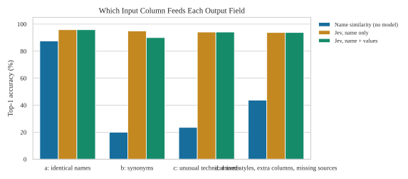
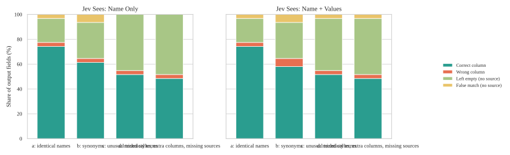
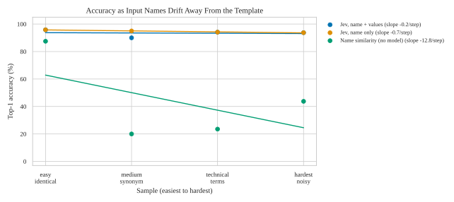
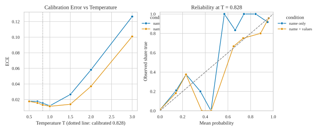
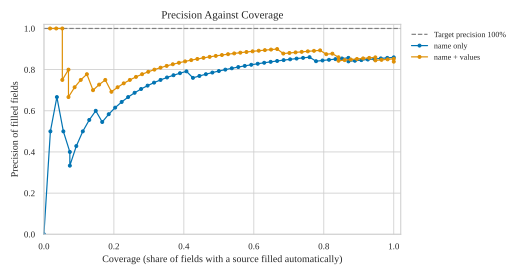
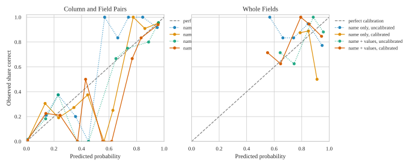

# Results

Model: Jev-Style-2B-Decision-v3 (llama.cpp, local). Output fields are always given by name only. For each input column the model sees: **name only** = the header text; **name + values** = the header and 5 values taken from the rows (file keys: `name`, `samples`).

| sample | input, expected, ground truth | Jev outputs (this run) | input naming |
|---|---|---|---|
| a | data/samples/a_easy_identical/ | a_easy_identical/ | identical names |
| b | data/samples/b_medium_synonym/ | b_medium_synonym/ | synonyms |
| c | data/samples/c_technical_terms/ | c_technical_terms/ | unusual technical terms |
| d | data/samples/d_hardest_noisy/ | d_hardest_noisy/ | mixed styles, extra columns, missing sources |

Per sample and context: the converted file (made without ground truth), the decisions and the probability matrix. Raw model output for everything: `result.json`.

## At a Glance

- **name only, options mode**: top-1 94.8%, exact 87.0%. Fields without a source left empty: 93.6% with the fixed rule. Without ground truth help: 49 of 77 fields correct, 62.7% of cells correct, 68 cells wrongly filled. 18 s per file.
- **name + values, options mode**: top-1 93.5%, exact 87.0%. Fields without a source left empty: 89.4% with the fixed rule. Without ground truth help: 52 of 77 fields correct, 67.2% of cells correct, 117 cells wrongly filled. 18 s per file.

Heatmaps: `figures/heatmap_<sample>_<context>.svg`.

## Auto-Fill or Review

- name only: no cutoff reaches 100% precision with enough fields, so nothing is filled automatically.
- name + values: no cutoff reaches 100% precision with enough fields, so nothing is filled automatically.

Fields below the cutoff stay empty in `converted_*.csv` and are listed with three candidates in `review_*.csv`. Precision counts a filled field as right only when every cell matches; a field without a source that was filled counts as wrong. Coverage is the share of fields with a source that were filled.

| Jev sees | sample | fields filled | filled correct | precision % | coverage % | fields to review |
|---|---|---|---|---|---|---|
| name only | easy_identical-000 | 0 | 0 | - | 0.0 | 31 |
| name only | medium_synonym-000 | 0 | 0 | - | 0.0 | 31 |
| name only | technical_terms-000 | 0 | 0 | - | 0.0 | 31 |
| name only | hardest_noisy-000 | 0 | 0 | - | 0.0 | 31 |
| name + values | easy_identical-000 | 0 | 0 | - | 0.0 | 31 |
| name + values | medium_synonym-000 | 0 | 0 | - | 0.0 | 31 |
| name + values | technical_terms-000 | 0 | 0 | - | 0.0 | 31 |
| name + values | hardest_noisy-000 | 0 | 0 | - | 0.0 | 31 |

## Calibration

ECE is the average gap between predicted probability and observed frequency (0 is perfect). Held-out means this run was not used to fit.

| Jev sees | level | points | ECE uncalibrated | ECE calibrated | data |
|---|---|---|---|---|---|
| name only | pair | 2263 | 0.015 | 0.006 | held-out |
| name only | field | 57 | 0.159 | 0.072 | held-out |
| name + values | pair | 2263 | 0.013 | 0.006 | held-out |
| name + values | field | 62 | 0.085 | 0.099 | held-out |

All numbers are percentages unless noted. Samples, easiest to hardest: easy_identical (names equal the template), medium_synonym, technical_terms (unusual technical terms such as OBJ_INFO_ADDR), hardest_noisy (mixed styles, extra columns, missing sources). One file per sample: read the numbers as indications.

## Converted File Without Ground Truth Help

Columns, transformation, and expression all come from the model's own choices. Fields correct = every cell matches the expected file. Wrongly filled = fields that have no source but were filled.

| Jev sees | sample | fields with a source correct | fields without a source wrongly filled | cells expected | cells correct % | wrongly filled cells |
|---|---|---|---|---|---|---|
| name only | easy_identical-000 | 15 of 24 | 1 of 7 | 384 | 62.5 | 16 |
| name only | medium_synonym-000 | 14 of 20 | 2 of 11 | 520 | 70.0 | 52 |
| name only | technical_terms-000 | 8 of 17 | 0 of 14 | 493 | 47.1 | 0 |
| name only | hardest_noisy-000 | 12 of 16 | 0 of 15 | 320 | 75.0 | 0 |
| name + values | easy_identical-000 | 15 of 24 | 1 of 7 | 384 | 62.5 | 16 |
| name + values | medium_synonym-000 | 14 of 20 | 2 of 11 | 520 | 70.0 | 52 |
| name + values | technical_terms-000 | 10 of 17 | 1 of 14 | 493 | 58.8 | 29 |
| name + values | hardest_noisy-000 | 13 of 16 | 1 of 15 | 320 | 81.2 | 20 |

## Mapping: Which Input Column Feeds Each Output Field (options mode)

### Jev sees: name only

| sample | cases | top1 | exact | top3 | reject n/a | decoy flagged | pair F1 | ECE |
|---|---|---|---|---|---|---|---|---|
| easy_identical | 1 | 95.8 | 87.5 | 100.0 | 85.7 | - | 70.6 | 0.024 |
| medium_synonym | 1 | 95.0 | 90.0 | 100.0 | 81.8 | - | 73.2 | 0.017 |
| technical_terms | 1 | 94.1 | 82.4 | 100.0 | 100.0 | - | 57.1 | 0.021 |
| hardest_noisy | 1 | 93.8 | 87.5 | 100.0 | 100.0 | 0.0 | 84.8 | 0.007 |
| all | 4 | 94.8 | 87.0 | 100.0 | 93.6 | - | 71.9 | 0.015 |

### Jev sees: name + values

| sample | cases | top1 | exact | top3 | reject n/a | decoy flagged | pair F1 | ECE |
|---|---|---|---|---|---|---|---|---|
| easy_identical | 1 | 95.8 | 87.5 | 100.0 | 85.7 | - | 70.6 | 0.023 |
| medium_synonym | 1 | 90.0 | 85.0 | 100.0 | 81.8 | - | 73.2 | 0.016 |
| technical_terms | 1 | 94.1 | 88.2 | 100.0 | 92.9 | - | 64.5 | 0.019 |
| hardest_noisy | 1 | 93.8 | 87.5 | 100.0 | 93.3 | 75.0 | 81.1 | 0.009 |
| all | 4 | 93.5 | 87.0 | 100.0 | 89.4 | - | 72.5 | 0.013 |

### Baseline without a model (string similarity of names only)

| sample | top1 | exact | top3 |
|---|---|---|---|
| easy_identical | 87.5 | 79.2 | 95.8 |
| medium_synonym | 20.0 | 15.0 | 20.0 |
| technical_terms | 23.5 | 23.5 | 41.2 |
| hardest_noisy | 43.8 | 37.5 | 62.5 |

## Temperature and calibration (pooled)

Probability = sigmoid((s_true - s_false) / T). T = 0.828 is the calibrated value. top1 does not depend on T.

Jev sees: name only

| T | ECE | Brier | pair F1 | precision | recall |
|---|---|---|---|---|---|
| 0.500 | 0.018 | 0.019 | 71.9 | 94.8 | 57.9 |
| 0.700 | 0.018 | 0.018 | 71.9 | 94.8 | 57.9 |
| 0.828 | 0.015 | 0.018 | 71.9 | 94.8 | 57.9 |
| 1.000 | 0.012 | 0.018 | 71.9 | 94.8 | 57.9 |
| 1.500 | 0.027 | 0.018 | 71.9 | 94.8 | 57.9 |
| 2.000 | 0.058 | 0.021 | 71.9 | 94.8 | 57.9 |
| 3.000 | 0.126 | 0.034 | 71.9 | 94.8 | 57.9 |

Jev sees: name + values

| T | ECE | Brier | pair F1 | precision | recall |
|---|---|---|---|---|---|
| 0.500 | 0.018 | 0.019 | 72.5 | 89.2 | 61.1 |
| 0.700 | 0.016 | 0.018 | 72.5 | 89.2 | 61.1 |
| 0.828 | 0.013 | 0.018 | 72.5 | 89.2 | 61.1 |
| 1.000 | 0.011 | 0.017 | 72.5 | 89.2 | 61.1 |
| 1.500 | 0.014 | 0.017 | 72.5 | 89.2 | 61.1 |
| 2.000 | 0.037 | 0.019 | 72.5 | 89.2 | 61.1 |
| 3.000 | 0.101 | 0.028 | 72.5 | 89.2 | 61.1 |

## Rejecting Fields Without a Source

A field is kept when its best input column passes the rule. Kept = fields with a source that are kept; Rejected = fields without a source that are left empty; Decoys = kept fields whose best column is a distractor. Cutoffs fitted on this run are optimistic (same data); cutoffs fitted on another run are a fair test.

| Jev sees | rule | kept % | rejected % | balanced % | top-1 when kept % | distractors |
|---|---|---|---|---|---|---|
| name only | fixed, probability 0.5 | 70.1 | 93.6 | 81.9 | 100.0 | 0 |
| name only | score cutoff -0.47, fitted on this run, optimistic | 74.0 | 93.6 | 83.8 | 96.5 | 0 |
| name only | lift cutoff 4.14, fitted on this run, optimistic | 79.2 | 87.2 | 83.2 | 98.4 | 1 |
| name + values | fixed, probability 0.5 | 74.0 | 89.4 | 81.7 | 100.0 | 1 |
| name + values | score cutoff 0.41, fitted on this run, optimistic | 74.0 | 91.5 | 82.8 | 100.0 | 0 |
| name + values | lift cutoff 4.62, fitted on this run, optimistic | 84.4 | 83.0 | 83.7 | 96.9 | 2 |
