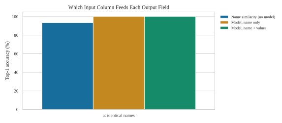
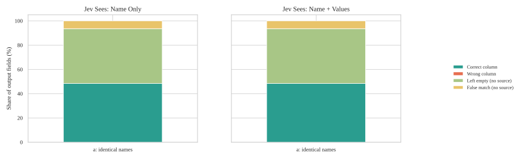
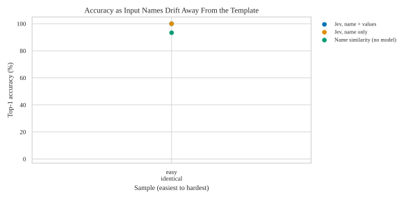
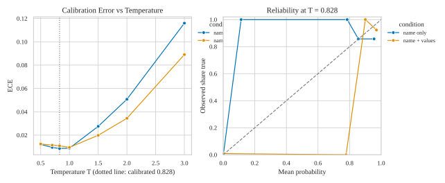
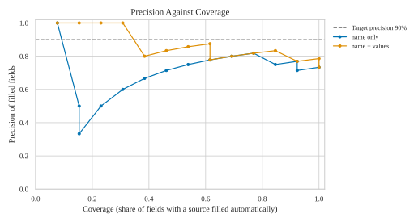
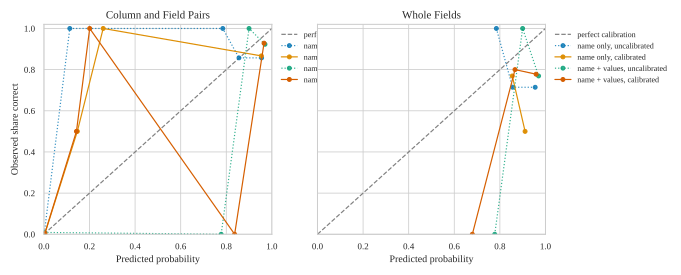

# Results

Model: Jev-Style-2B-Decision-v3 (llama.cpp, local). Output fields are always given by name only. For each input column the model sees: **name only** = the header text; **name + values** = the header and 5 values taken from the rows (file keys: `name`, `samples`).

| sample | input, expected, ground truth | Jev outputs (this run) | input naming |
|---|---|---|---|
| a | data/samples/a_easy_identical/ | a_easy_identical/ | identical names |

Per sample and context: the converted file (made without ground truth), the decisions and the probability matrix. Raw model output for everything: `result.json`.

## At a Glance

- **name only, options mode**: top-1 100.0%, exact 100.0%. Fields without a source left empty: 87.5% with the fixed rule. Without ground truth help: 11 of 15 fields correct, 73.3% of cells correct, 34 cells wrongly filled. 14 s per file, 3k prompt tokens.
- **name + values, options mode**: top-1 100.0%, exact 100.0%. Fields without a source left empty: 87.5% with the fixed rule. Without ground truth help: 11 of 15 fields correct, 73.3% of cells correct, 34 cells wrongly filled. 14 s per file, 4k prompt tokens.

Heatmaps: `figures/heatmap_<sample>_<context>.svg`.

## Auto-Fill or Review

- name only: no cutoff reaches 100% precision with enough fields, so nothing is filled automatically.
- name + values: no cutoff reaches 100% precision with enough fields, so nothing is filled automatically.

Fields below the cutoff stay empty in `converted_*.csv` and are listed with three candidates in `review_*.csv`. Precision counts a filled field as right only when every cell matches; a field without a source that was filled counts as wrong. Coverage is the share of fields with a source that were filled.

| Jev sees | sample | fields filled | filled correct | precision % | coverage % | fields to review |
|---|---|---|---|---|---|---|
| name only | easy_identical-000 | 0 | 0 | - | 0.0 | 31 |
| name + values | easy_identical-000 | 0 | 0 | - | 0.0 | 31 |

## Calibration

ECE is the average gap between predicted probability and observed frequency (0 is perfect). Held-out means this run was not used to fit.

| Jev sees | level | points | ECE uncalibrated | ECE calibrated | data |
|---|---|---|---|---|---|
| name only | pair | 465 | 0.009 | 0.009 | held-out |
| name only | field | 15 | 0.193 | 0.129 | held-out |
| name + values | pair | 465 | 0.011 | 0.006 | held-out |
| name + values | field | 15 | 0.232 | 0.176 | held-out |

All numbers are percentages unless noted. Samples, easiest to hardest: easy_identical (names equal the template), medium_synonym, technical_terms (unusual technical terms such as OBJ_INFO_ADDR), hardest_noisy (mixed styles, extra columns, missing sources). One file per sample: read the numbers as indications.

## Converted File Without Ground Truth Help

Columns, transformation, and expression all come from the model's own choices. Fields correct = every cell matches the expected file. Wrongly filled = fields that have no source but were filled.

| Jev sees | sample | fields with a source correct | fields without a source wrongly filled | cells expected | cells correct % | wrongly filled cells |
|---|---|---|---|---|---|---|
| name only | easy_identical-000 | 11 of 15 | 2 of 16 | 255 | 73.3 | 34 |
| name + values | easy_identical-000 | 11 of 15 | 2 of 16 | 255 | 73.3 | 34 |

## Mapping: Which Input Column Feeds Each Output Field (options mode)

### Jev sees: name only

| sample | cases | top1 | exact | top3 | reject n/a | decoy flagged | pair F1 | ECE |
|---|---|---|---|---|---|---|---|---|
| easy_identical | 1 | 100.0 | 100.0 | 100.0 | 87.5 | - | 81.2 | 0.009 |
| all | 1 | 100.0 | 100.0 | 100.0 | 87.5 | - | 81.2 | 0.009 |

### Jev sees: name + values

| sample | cases | top1 | exact | top3 | reject n/a | decoy flagged | pair F1 | ECE |
|---|---|---|---|---|---|---|---|---|
| easy_identical | 1 | 100.0 | 100.0 | 100.0 | 87.5 | - | 81.2 | 0.011 |
| all | 1 | 100.0 | 100.0 | 100.0 | 87.5 | - | 81.2 | 0.011 |

### Baseline without a model (string similarity of names only)

| sample | top1 | exact | top3 |
|---|---|---|---|
| easy_identical | 93.3 | 93.3 | 93.3 |

## Temperature and calibration (pooled)

Probability = sigmoid((s_true - s_false) / T). T = 0.828 is the calibrated value. top1 does not depend on T.

Jev sees: name only

| T | ECE | Brier | pair F1 | precision | recall |
|---|---|---|---|---|---|
| 0.500 | 0.012 | 0.012 | 81.2 | 86.7 | 76.5 |
| 0.700 | 0.009 | 0.012 | 81.2 | 86.7 | 76.5 |
| 0.828 | 0.009 | 0.011 | 81.2 | 86.7 | 76.5 |
| 1.000 | 0.009 | 0.011 | 81.2 | 86.7 | 76.5 |
| 1.500 | 0.028 | 0.011 | 81.2 | 86.7 | 76.5 |
| 2.000 | 0.051 | 0.012 | 81.2 | 86.7 | 76.5 |
| 3.000 | 0.116 | 0.023 | 81.2 | 86.7 | 76.5 |

Jev sees: name + values

| T | ECE | Brier | pair F1 | precision | recall |
|---|---|---|---|---|---|
| 0.500 | 0.012 | 0.012 | 81.2 | 86.7 | 76.5 |
| 0.700 | 0.011 | 0.012 | 81.2 | 86.7 | 76.5 |
| 0.828 | 0.011 | 0.011 | 81.2 | 86.7 | 76.5 |
| 1.000 | 0.010 | 0.011 | 81.2 | 86.7 | 76.5 |
| 1.500 | 0.020 | 0.010 | 81.2 | 86.7 | 76.5 |
| 2.000 | 0.034 | 0.010 | 81.2 | 86.7 | 76.5 |
| 3.000 | 0.089 | 0.016 | 81.2 | 86.7 | 76.5 |

## Rejecting Fields Without a Source

A field is kept when its best input column passes the rule. Kept = fields with a source that are kept; Rejected = fields without a source that are left empty; Decoys = kept fields whose best column is a distractor. Cutoffs fitted on this run are optimistic (same data); cutoffs fitted on another run are a fair test.

| Jev sees | rule | kept % | rejected % | balanced % | top-1 when kept % | distractors |
|---|---|---|---|---|---|---|
| name only | fixed, probability 0.5 | 86.7 | 87.5 | 87.1 | 100.0 | 0 |
| name only | score cutoff -2.11, fitted on this run, optimistic | 100.0 | 87.5 | 93.8 | 100.0 | 0 |
| name + values | fixed, probability 0.5 | 86.7 | 87.5 | 87.1 | 100.0 | 0 |
| name + values | score cutoff -2.48, fitted on this run, optimistic | 93.3 | 87.5 | 90.4 | 100.0 | 0 |
